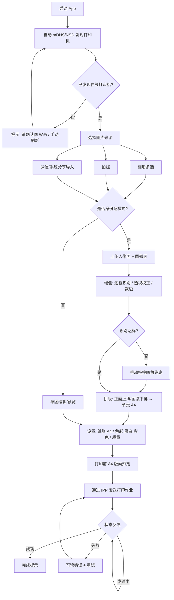

# 无广告打印机 App — 简单 PRD（默认模式）

> 文档状态：初稿（v0.1） ｜ 角色：产品经理 许清楚（Xu） ｜ 日期：2026-10-26

---

## 1. 项目信息

| 项 | 内容 |
|---|---|
| Language | 中文 |
| Programming Language | Flutter（原生，一套代码出 Android + iOS） |
| Project Name | `ad_free_printer_app` |
| 原始需求复述 | 用户现用「小白学习打印机」官方 App，广告泛滥（连身份证照片识别都要先看广告），体验极差。希望我们做一款**无广告**的打印机 App 替代它，支持局域网自动发现打印机、通过 IPP 协议打印，并重点提供**本地（端侧）身份证识别裁边 + 拼版**功能，隐私优先、不上传云端。 |

---

## 2. 产品目标

**一句话目标**：做一款零广告、隐私优先的通用打印机 App，让用户无打扰地把手机里的照片/身份证打印到 A4 纸上。

核心目标（正交）：
1. **无广告、纯净体验** —— 全程无开屏/插页/功能前置广告，核心功能零门槛可用。
2. **局域网零配置打印** —— 手机与打印机同 WiFi，mDNS/NSD 自动发现，IPP 通用协议直连打印。
3. **本地身份证智能排版** —— 端侧识别边框、透视校正、裁边，正反两面拼到一张 A4，秒出证件照。
4. **隐私优先** —— 身份证等敏感图片仅在设备本地处理，绝不上传云端。
5. **多来源图片输入** —— 相册、拍照、微信（系统分享）三种导入路径全覆盖。

---

## 3. 用户故事

1. 作为**普通用户**，我希望打开 App 就能看到同一 WiFi 下在线的打印机，以便无需手动配置 IP 就能直接打印。
2. 作为**学生/家长**，我希望从相册选一张作业图点几下就能打到 A4 上，以便摆脱原 App 的广告骚扰。
3. 作为**需要办证件的用户**，我希望上传身份证正反面后 App 自动裁正、拼版，以便一张 A4 打出合规证件照，且照片不外泄。
4. 作为**微信重度用户**，我希望把微信里收到的图片通过系统分享直接送进打印 App，以便不用先存相册再导入。
5. 作为**注重隐私的用户**，我希望身份证识别全程在手机本地完成、断网也能用，以便放心处理敏感证件。
6. 作为**普通用户**，我希望打印前能选黑白/彩色并能预览版面，以便控制效果和耗材成本。

---

## 4. 需求池（按优先级）

### P0（Must have — 上线必备）

**P0-1 局域网打印机自动发现与在线状态**
- 描述：通过 mDNS（iOS/Bonjour）/ NSD（Android）在同一 WiFi 下自动发现支持 IPP 的网络打印机，列表展示设备名、IP、在线/离线状态，支持手动刷新。
- 验收标准：
  - 同网段内主流网络打印机（爱普生/惠普/佳能等）启动后 10 秒内出现在列表且标记「在线」。
  - 打印机断电/离线后状态在 30 秒内更新为「离线」。
  - 无需用户输入 IP 或安装驱动即可发现。

**P0-2 IPP 协议打印（单图 → A4）**
- 描述：对选定图片按 A4 纸张、指定色彩模式，通过 IPP 协议发送到打印机。
- 验收标准：
  - 支持向 IPP 端点（通常为 `ipp://<ip>:631/ipp/print`）提交打印作业。
  - 黑白（灰度）与彩色两种模式可切换且实际输出与设置一致。
  - 打印作业返回成功/失败状态。

**P0-3 图片来源：相册 / 拍照 / 微信导入**
- 描述：提供三种图片入口 —— ①系统相册多选；②调用相机拍照；③接收系统分享（从微信等把图片分享进来）。
- 验收标准：
  - 相册可多选图片并进入编辑/打印流程。
  - 拍照后即时得到图片，可继续编辑。
  - 从微信「分享」→ 本 App，图片能被接收并进入流程（走系统分享接收，非直接读取微信沙盒）。

**P0-4 纸张与色彩设置**
- 描述：打印前设置纸张为 A4、色彩模式黑白（灰度）/彩色。
- 验收标准：
  - 默认 A4；色彩模式默认黑白，可切彩色。
  - 设置项在发送到打印机前明确生效。

**P0-5 身份证本地识别与拼版打印**
- 描述：用户分别上传身份证「人像面」与「国徽面」两张图；App 在端侧自动识别证件边框、做透视校正、裁边优化，并支持把两面「上排/下排」拼到一张 A4 上打印。
- 验收标准：
  - 识别与校正**全部在本地完成**，全程无网络上传（可飞行模式验证）。
  - 自动检测四角并透视校正；校正失败提供手动拖拽四角兜底。
  - 拼版支持正面上排/国徽下排（及镜像可切换），输出为单张 A4 拼版图。
  - 拼版预览所见即所得，打印结果与预览一致。

**P0-6 隐私与无广告底线**
- 描述：全 App 无任何广告（开屏、插页、功能前置广告均禁止）；身份证类敏感图片仅在本地处理，不落云、不上传、不用于模型训练。
- 验收标准：
  - 任意功能路径均不出现广告位。
  - 身份证图片处理期间断开网络仍可完成（证明本地化）。

**P0-7 打印状态反馈**
- 描述：打印过程给用户清晰状态：发送中 / 成功 / 失败，失败给出可读原因。
- 验收标准：
  - 提交后 1 秒内显示「发送中」。
  - 成功或失败有明确提示；失败包含原因（如离线、作业被拒、卡纸等可读文案）。

---

### P1（Should have — 重要增强）

**P1-1 打印机列表管理**
- 描述：记住近期使用过的打印机，支持置顶常用设备、删除/重命名、手动刷新。
- 验收标准：重启 App 后仍展示历史设备；可手动刷新在线状态。

**P1-2 打印前 A4 版面预览**
- 描述：在发送前以 A4 比例预览最终版面（图片缩放/拼版位置）。
- 验收标准：预览比例与真实 A4 一致；拼版/单图位置所见即所得。

**P1-3 多图连续/排版打印**
- 描述：一次选择多张图片，可依次打印，或按多合一版式排到一张 A4。
- 验收标准：多选后可设定「每张单独打印」或「N 合一」版式预览后输出。

**P1-4 身份证识别失败手动兜底**
- 描述：自动识别置信度低时，允许用户手动调整四角与裁边范围。
- 验收标准：手动模式可拖拽四角并实时预览校正结果。

**P1-5 打印质量/分辨率设置**
- 描述：提供打印质量档位（草稿/标准/高质量）映射到 IPP 属性。
- 验收标准：切换档位后实际输出清晰度有可感知差异。

**P1-6 错误重试与可读提示**
- 描述：打印失败支持一键重试；对常见错误（离线、打印机忙、纸张不足、作业拒绝）给出友好文案与建议。
- 验收标准：失败页含「重试」按钮；错误文案非原始技术码。

---

### P2（Nice to have — 后续迭代）

**P2-1 打印历史**：记录最近打印的图片缩略图、时间、设备，支持重打。
**P2-2 双面打印**：支持 IPP `sides=two-sided` 双面输出。
**P2-3 自定义纸张/尺寸**：除 A4 外支持 A5、照片纸等尺寸与方向。
**P2-4 证件类型扩展**：护照、户口本、驾驶证等模板拼版。
**P2-5 暗黑模式**：跟随系统或手动切换深色主题。

---

## 5. UI 流程

文字步骤摘要：启动 → 自动发现同 WiFi 打印机并显示在线状态 → 选图（相册/拍照/微信导入）→ 若是身份证则上传正反面并端侧校正裁边拼版，否则单图预览 → 设置纸张 A4 与色彩模式 → A4 版面预览 → IPP 发送 → 实时状态（发送中/成功/失败可重试）。

---

## 6. 待确认问题（Open Questions）

1. **双面打印**：首版是否需要支持 IPP 双面（`sides=two-sided`）？还是仅单面，留待 P2？
2. **打印历史**：是否需要「最近打印」记录与一键重打？影响本地存储与权限设计。
3. **微信导入方式**：系统分享（无需 SDK、最稳）是否满足？还是要求集成微信 OpenSDK 做更深度拉取（需企业资质与审核）？
4. **端侧识别引擎**：身份证边框识别用何种端侧方案（如 TensorFlow Lite / 平台 ML / 自研 OpenCV 透视校正）？准确率目标与机型性能下限需明确。
5. **IPP 认证与适配**：部分打印机需用户名/密码或仅支持特定 IPP 属性，首版是否要求支持认证；是否维护「已知可用机型」白名单还是纯通用 IPP 全兼容？
6. **纸张与尺寸**：首版严格只做 A4，还是一并支持 A5/照片纸等（关系到打印参数与预览复杂度）？

---

> 备注：本 PRD 为**简单模式**，未含竞品分析与象限图。需求优先级 P0 为上线硬门槛，P1 为重要增强，P2 为后续迭代。所有涉及身份证的图像处理须坚守「本地端侧、不上传」红线。
